#  TaskPro

**_TaskPro_** This is the perfect tool that reflects the user's values for
effective task management.

**TaskPro** highly values data security and confidentiality. In our application,
advanced encryption methods and reliable authentication mechanisms are employed
to ensure that your confidential information remains secure.

To get started with the application, registration is required. For your
convenience, we have also implemented registration through a Google account.
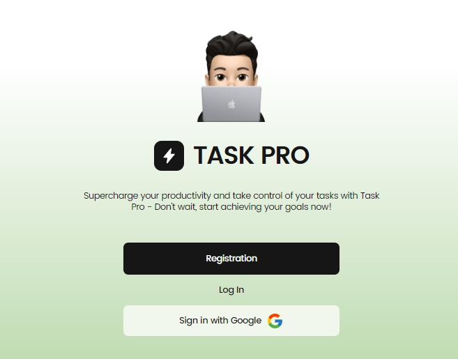

After registration, the user is directed to the home page, where they can start
working with the application immediately. 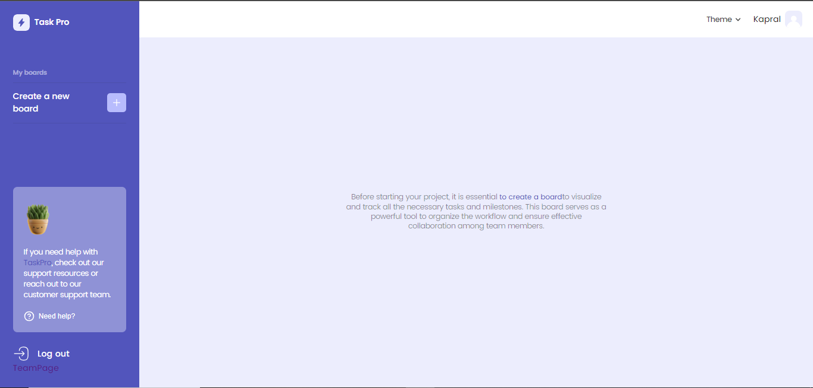

The application's functionality includes:

1. Creating a new board (where users can add columns with tasks).
   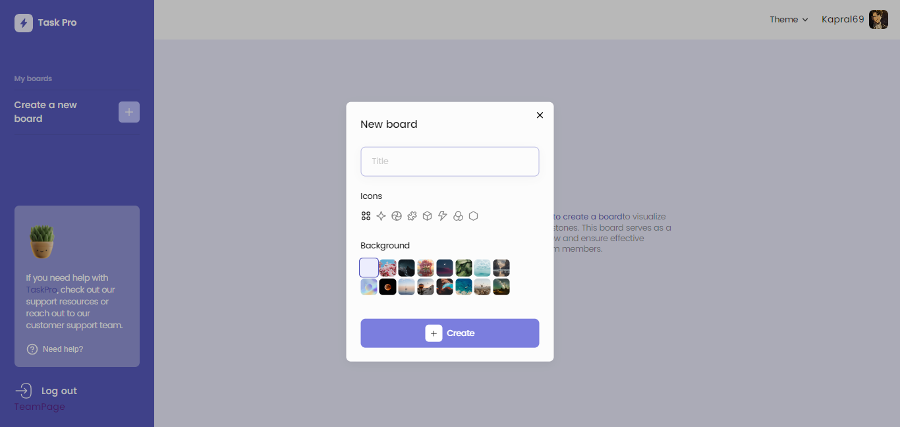
2. Editing boards (users can choose a suitable label and background for the
   board). 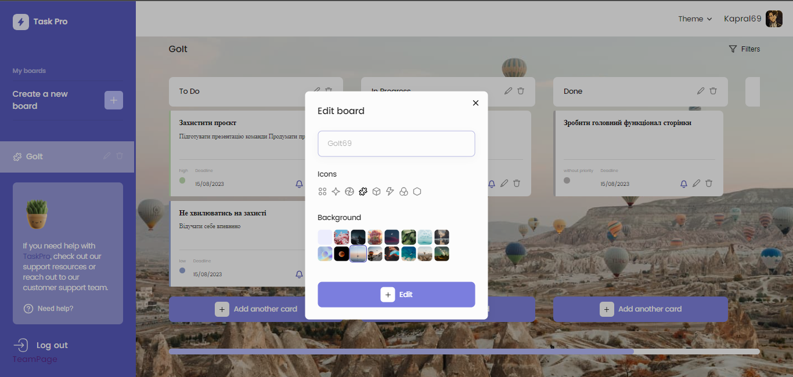
3. Editing columns. 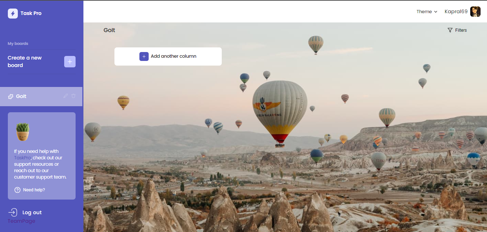
4. Creating/editing tasks (users can set task priorities and due dates).
   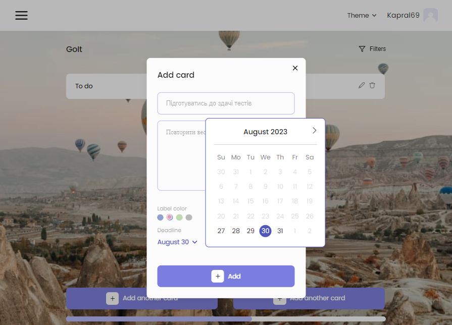 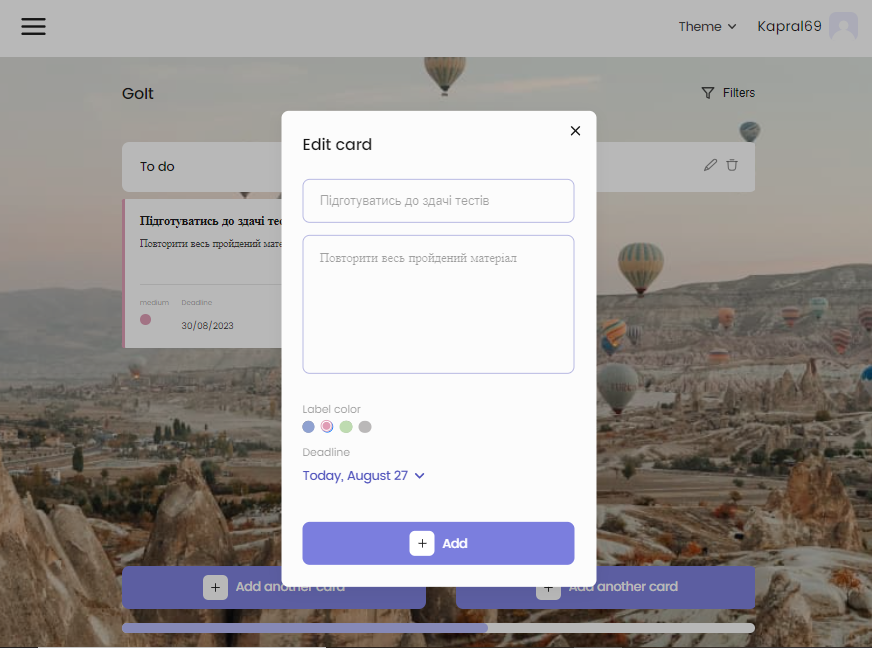
5. Task filtering. 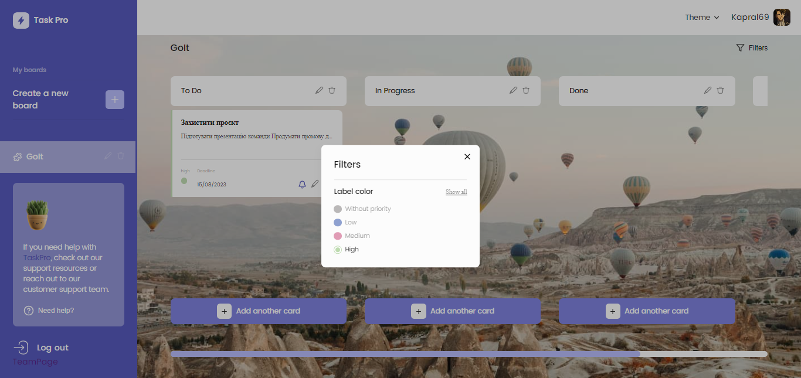
6. Changing the app's theme. 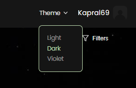
7. Modifying user profiles (the ability to set an avatar, change name, email,
   and password). 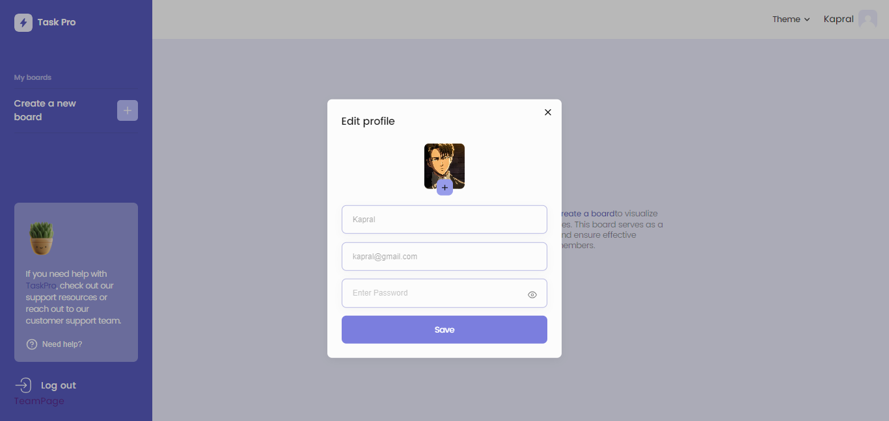
8. Technical support (if users have specific questions or suggestions for
   improving the application, they can send us an email).
   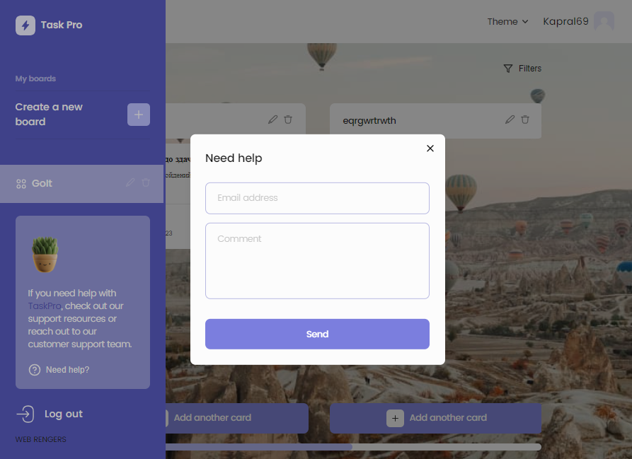

---

## Tech Stack

**Frontend:** React, Redux Toolkit, React Router, Axios, Formik + Yup, React Beautiful DnD, SCSS, Emotion

**Backend:** Node.js, Express, MongoDB, Mongoose, JWT, Multer

**Deployment:** Netlify (frontend), Render (backend), MongoDB Atlas (database)

## Getting Started

### Prerequisites

- Node.js (v18 or higher)
- npm
- MongoDB Atlas account (free tier works fine)

### Installation

1. Clone the repository:

```bash
git clone https://github.com/Ynln69/quest-board-app.git
cd quest-board-app
```

2. Install frontend dependencies:

```bash
npm install
```

3. Install backend dependencies:

```bash
cd backend
npm install
```

4. Set up the environment variables:

Create a `.env` file in the `backend/` folder:

```
MONGODB_URI=your_mongodb_connection_string
JWT_SECRET=your_secret_key
FRONTEND_URL=http://localhost:3000
PORT=5001
```

Create a `.env` file in the root folder:

```
REACT_APP_API_BASE_URL=http://localhost:5001
```

5. Start the backend server:

```bash
cd backend
npm run dev
```

6. In a separate terminal, start the frontend:

```bash
npm start
```

The app will be available at `http://localhost:3000`.

## Project Structure

```
quest-board-app/
├── public/                  # Static files
├── src/
│   ├── components/          # React components
│   ├── pages/               # Page-level components
│   ├── redux/               # State management (auth, boards, filter)
│   ├── schemas/             # Yup validation schemas
│   ├── hooks/               # Custom hooks
│   ├── constants/           # App constants
│   ├── scss/                # Global styles and themes
│   └── images/              # Icons, avatars, sprites
├── backend/
│   ├── models/              # Mongoose schemas (User, Board)
│   ├── routes/              # API endpoints
│   ├── middleware/           # Auth middleware
│   └── server.js            # Express entry point
└── package.json
```

## API Endpoints

| Method | Endpoint              | Description            |
| ------ | --------------------- | ---------------------- |
| POST   | `/api/auth/register`  | Register a new user    |
| POST   | `/api/auth/login`     | Log in                 |
| POST   | `/api/auth/logout`    | Log out                |
| GET    | `/api/users/current`  | Get current user       |
| PATCH  | `/api/users/current`  | Update profile         |
| PATCH  | `/api/users/avatars`  | Upload avatar          |
| GET    | `/api/boards`         | Get all boards         |
| POST   | `/api/boards`         | Create a board         |
| PATCH  | `/api/boards/:id`     | Update a board         |
| DELETE | `/api/boards/:id`     | Delete a board         |
| POST   | `/api/helper`         | Send a support request |

## Features

- Drag-and-drop task management between columns
- Three color themes (Light, Dark, Violet)
- Google OAuth integration
- Real-time board background customization
- Task priorities and deadlines
- Responsive design for mobile and desktop

## Live Demo

- **Frontend:** [task-pro-app.netlify.app](https://task-pro-app.netlify.app)
- **Backend:** [taskpro-backend-xyan.onrender.com](https://taskpro-backend-xyan.onrender.com)
